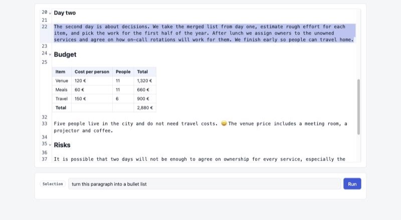
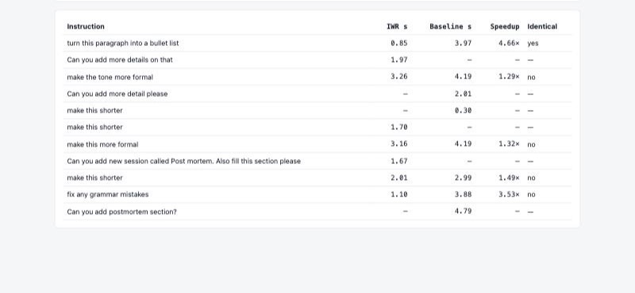
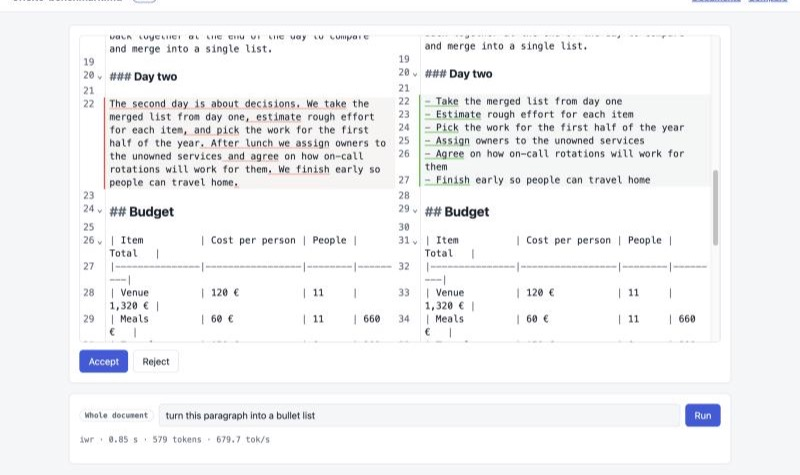
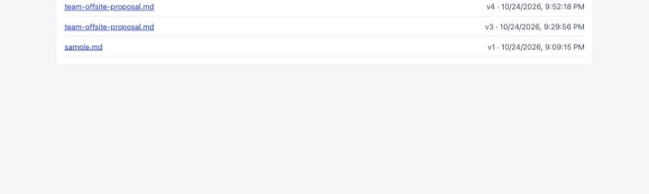

# inference-with-reference

A Cursor-style Markdown editor that rewrites a selection (or the whole document) with a local LLM, and measures how much faster decoding gets when the model is allowed to **copy from the document it is editing**.



## Why

When you ask a model to edit a document, most of its answer already exists in the prompt: the unchanged sentences, the table, the headings. Normal decoding still produces every one of those tokens with its own forward pass.

**Inference with Reference** (Yang et al., 2023, also known as LLMA or prompt-lookup decoding) takes a shortcut. It looks up the last few generated tokens in the reference text, the document here, and proposes the tokens that followed them there as a draft. The model checks the whole draft in a single forward pass and keeps the longest correct prefix. Long copied spans cost one step instead of dozens, and the accepted text is exactly what the model would have written anyway.

This project wraps that idea in a small but complete app, so the speedup can be measured on real editing work rather than synthetic prompts.

## Results

Five edits on the [example document](examples/team-offsite-proposal.md) (about 600 output tokens each), run once with vLLM's `ngram` speculation and once without it. Same model, GPU, prompts and settings; temperature 0; warm cache.

| Edit | Scope | Baseline | IWR | Speedup |
|---|---|---:|---:|---:|
| turn this paragraph into a bullet list | selection | 3.97 s | 0.85 s | **4.66×** |
| fix any grammar mistakes | whole document | 3.88 s | 1.10 s | **3.53×** |
| make this shorter | selection | 2.99 s | 2.01 s | 1.49× |
| make this more formal | selection | 4.19 s | 3.16 s | 1.32× |
| make the tone more formal | whole document | 4.19 s | 3.26 s | 1.29× |
| **Total** | | **19.22 s** | **10.38 s** | **1.85×** |

Model: `mistralai/Ministral-3-8B-Instruct-2512` on vLLM 0.28 with one NVIDIA RTX PRO 6000 (Blackwell). Baseline runs at about 150 tokens/s; with IWR the same edits run at 190 to 680 tokens/s.

What the numbers show:

- **The more of the document survives an edit, the bigger the win.** A grammar pass or a reformatting keeps most words, so long drafts are accepted. A tone rewrite changes most words, so drafts are rejected more often and the gain drops to about 1.3×.
- **Selection edits benefit too**, because the model returns the full document and everything outside the selection is copied.
- **Outputs are not always byte-identical.** Speculative decoding is lossless in exact arithmetic, but batched bf16 kernels are not bit-reproducible, so long greedy outputs can drift after a near-tie. One of the five edits matched byte for byte; the others differ in wording, not quality.

This is a small sample on one machine. Run your own edits and check the **Compare** page.



## Features

- **Upload** `.txt` or `.md` files (UTF-8, up to 1 MB). Each accepted edit is stored as a new version in MinIO.
- **Markdown editor** (CodeMirror 6). Headings, bold, italics, links and GFM tables are rendered in place. Clicking a heading or table shows its Markdown source for editing.
- **Edit a selection or the whole document** with a plain-language instruction. Nothing outside the selection can change.
- **Diff review.** Every proposal opens in a side-by-side diff with Accept and Reject.
- **Timing on every run**: seconds, output tokens and tokens/s, recorded per mode.
- **Compare page.** It pairs the same edit across modes and shows the speedup and whether the outputs match.



## How it works


1. **Prime.** Opening a document sends one request with the system prompt and the document and `max_tokens=1`. vLLM's prefix cache now holds the document, so later edits skip most of the prompt processing.
2. **Wrap.** If you selected text, the server wraps it in place in `<highlighted-text>…</highlighted-text>`. The model never sees character offsets.
3. **Generate.** A LangChain `ChatOpenAI` call goes to vLLM's OpenAI-compatible API at temperature 0. The model is asked to return the **complete document**, with the tags around the rewritten part. That makes the output mostly a copy of the prompt, which is exactly what reference-based drafting accelerates.
4. **Splice.** The app takes only the text between the tags and puts it back into the original. Everything outside the selection comes from the original document, so the model cannot change it even if it tries.
   - If the model leaves out the tags, the app falls back to the text between the unchanged context before and after the selection.
   - For whole-document edits, any stray tags are removed.
5. **Record.** Each run stores the wall time of the model call, the output tokens, and two hashes:
   - a key over the document, the selection and the instruction, which pairs the same edit across modes;
   - a hash of the raw output, which shows whether both modes produced the same text.

One edit, step by step ([interactive page](docs/editor-agent-flow.html)):


### Inference with reference in vLLM

vLLM ships reference-based drafting as speculative decoding methods that need no draft model. This project uses `ngram`. It matches the last 2 to 4 generated tokens against the prompt and proposes up to 8 tokens that followed them there. The model verifies the whole draft in one forward pass.


For a step-by-step explainer with an interactive simulation, see [docs/iwr-explainer.html](docs/iwr-explainer.html).

### Model

The default model is Ministral 3 8B, a standard-attention model, which is the simplest case for speculative decoding.


## Getting started

You need:

- a Linux machine with an NVIDIA GPU, Docker and the NVIDIA container toolkit, for the vLLM server;
- Docker with Compose, for the app (any OS).

They can be the same machine.

### 1. Start the vLLM server

On the GPU machine:

```bash
./deploy/vllm/serve.sh                     # Ministral 3 8B with ngram speculation (IWR)
SPEC_METHOD=off ./deploy/vllm/serve.sh     # same model, no speculation (baseline)
```

The script starts a `vllm-iwr` container that serves the model as `drafting` on port 8001.

- **Network access:** it listens on `127.0.0.1` by default. If the app runs on another machine, set `BIND_ADDR` to an address on a private network the app can reach. The API has no authentication, so never expose it on a public interface.
- **Settings:** see [deploy/vllm/README.md](deploy/vllm/README.md) for all settings and a smoke test.

The first request after a start compiles kernels and can take a minute. Judge speed from the second request on.

### 2. Start the app

```bash
cp .env.example .env        # set VLLM_BASE_URL and MinIO credentials
docker compose up --build
```

Open http://localhost:8080. The MinIO console is at http://localhost:9001.

`VLLM_BASE_URL` defaults to `http://host.docker.internal:8001/v1`, which reaches a vLLM server on the same machine as Docker. Point it at your vLLM server otherwise.

### 3. Edit

1. Upload a document, or use [examples/team-offsite-proposal.md](examples/team-offsite-proposal.md).
2. Select text, or select nothing to edit the whole document. The chip shows which.
3. Type an instruction and press **Run**.
4. Review the diff, then **Accept** to save a new version or **Reject** to discard it.



### Compare IWR with the baseline

vLLM serves one mode at a time. `SPEC_MODE` in `.env` labels the runs.

1. With vLLM on `SPEC_METHOD=ngram` and `SPEC_MODE=iwr`, run your edits.
2. Restart vLLM with `SPEC_METHOD=off`, set `SPEC_MODE=baseline`, and restart the app with `docker compose up -d`.
3. Repeat the same edits: same document version, same selection, same instruction. Reject the proposals so the document doesn't change between runs.
4. Open http://localhost:8080/compare.

## Configuration

App (`.env`):

| Variable | Default | Meaning |
|---|---|---|
| `VLLM_BASE_URL` | `http://host.docker.internal:8001/v1` | OpenAI-compatible endpoint of the vLLM server |
| `VLLM_MODEL` | `drafting` | Served model name |
| `SPEC_MODE` | `iwr` | Label stored with each run: `iwr` or `baseline` |
| `MINIO_ENDPOINT` | `minio:9000` | MinIO address inside Compose |
| `MINIO_ACCESS_KEY`, `MINIO_SECRET_KEY` | — | MinIO credentials; also used to create the MinIO root user |

vLLM server (`deploy/vllm/serve.sh`, environment variables):

| Variable | Default | Meaning |
|---|---|---|
| `MODEL` | `mistralai/Ministral-3-8B-Instruct-2512` | Hugging Face model |
| `SPEC_METHOD` | `ngram` | `ngram`, `suffix` or `off` |
| `SPEC_TOKENS` | `8` | Max tokens drafted per step |
| `LOOKUP_MIN` / `LOOKUP_MAX` | `2` / `4` | n-gram sizes matched in the prompt |
| `BIND_ADDR` / `PORT` | `127.0.0.1` / `8001` | Where the API listens |
| `GPU_UTIL` | `0.30` | Share of the GPU's memory vLLM may use |
| `MAX_LEN` | `32768` | Max context length |

## API

| Method | Path | Purpose |
|---|---|---|
| `GET` | `/api/config` | Current `spec_mode` |
| `POST` | `/api/documents` | Upload (multipart `file`) |
| `GET` | `/api/documents` | List documents |
| `GET` | `/api/documents/{id}` | Latest version: `{meta, text}` |
| `POST` | `/api/documents/{id}/prime` | Warm vLLM's prefix cache with the document |
| `POST` | `/api/documents/{id}/edit` | `{instruction, selection: {from, to} \| null}` → `{proposed_text, run}` |
| `POST` | `/api/documents/{id}/versions` | Save accepted text as a new version |
| `GET` | `/api/runs/compare` | Paired runs per edit, speedups and totals |

`selection` offsets count Unicode code points (Python string indices).

## Project layout

```
app/
  main.py           FastAPI routes, static pages, error handling
  editor_chain.py   prompt, LangChain call to vLLM, timing
  highlight.py      wrap the selection, splice the rewrite back
  storage.py        MinIO documents, versions and runs
  compare.py        pair runs across modes
  static/           documents, editor (CodeMirror) and compare pages
deploy/vllm/        serve.sh and verify.sh for the vLLM server
docs/               diagrams, IWR explainer, design spec and plan
examples/           sample document
tests/              pytest suite
```

## Development

```bash
uv venv --python 3.12 .venv && uv pip install -r requirements.txt
.venv/bin/pytest
```

The diagram images in `docs/diagrams/` are exported from the HTML pages in `docs/`. After changing a page, run `python3 docs/export_diagrams.py`.

## Limitations

- Single user, no authentication. Run it on a trusted machine or network.
- Plain text and Markdown only. PDF or Word files would need converting to Markdown first.
- vLLM runs in one mode at a time, so comparing modes means restarting the server.
- No streaming. The diff appears when the whole response is done.

## References

- Nan Yang, Tao Ge, Liang Wang, Binxing Jiao, Daxin Jiang, Linjun Yang, Rangan Majumder, Furu Wei. *Inference with Reference: Lossless Acceleration of Large Language Models*. arXiv:2304.04487, 2023.
- [vLLM speculative decoding](https://docs.vllm.ai/en/latest/features/spec_decode.html): `ngram` and `suffix` methods.
